  

  

Hey, I'm **Rao**. A Computer Science student at the Institute of Space Technology with an inconvenient tendency to become interested in things, which has taken me through software, Android, AI, web products, competitive programming, creative work and community. I like turning "what if?" into something you can actually use.

I'm still figuring out whether these paths lead to a main quest. Until then, I'm building things and following the trail.

 

| Quest | Project | Type | Brief |
|:---:|---|---|---|
| `001` | **[Ustad-e-Karigar](https://github.com/M-Aamir-Rao/Ustad-e-Karigar)** | 📱 Android app 🤖 AI 🏆 National Finalist | A digital *ustad* for the real world, helping Pakistani repair workers and households diagnose problems, learn and keep track of their work. Describe an appliance fault by text, voice or photo and get structured **Gemini** answers with follow-up questions, tools, steps and warnings, double-checked by a separate rule-based **safety layer**. Works in English, Roman Urdu and Urdu (RTL + Nastaliq), with lessons and repair history stored on-device in **Room**. Built with **Kotlin** and **Jetpack Compose** for the BanoQabil x Alibaba AI Hackathon, where it made the **national finals**. |
| `002` | **[Meadow & Wood](https://github.com/M-Aamir-Rao/MeadowAndWood)** | 🌐 Web app 🗄️ Databases | A quieter kind of storefront: cottagecore furniture meets a practical sales and inventory management system. A public catalogue driven by **MySQL**, admin CRUD for inventory, recorded sales that update stock automatically, and session-based admin and customer roles with registration and expiring password-reset tokens. **PHP**, **MySQL**, JavaScript and CSS, built with Fatima Asad and Abdullah Khan Niazi. |

 

- 🧭 Hunting for the **main quest**. The side quests are going well in the meantime
- 🧪 Cooking up design experiments, tiny programs and visual studies for the *Side Paths* shelf of my portfolio
- 🚀 Leading ventures and product launches at **AFRIUM**
- 📣 Running social media and marketing at **DevCore**
- 🤖 Wandering toward AI-led development, visual direction and civic tech

 

  
  
  
  
  
  
  
  
  
  
  
  

  
  
  
  
  
  
  

 

 

 

If you're working on something interesting, there's a decent chance I'll want to hear about it.

  
  

